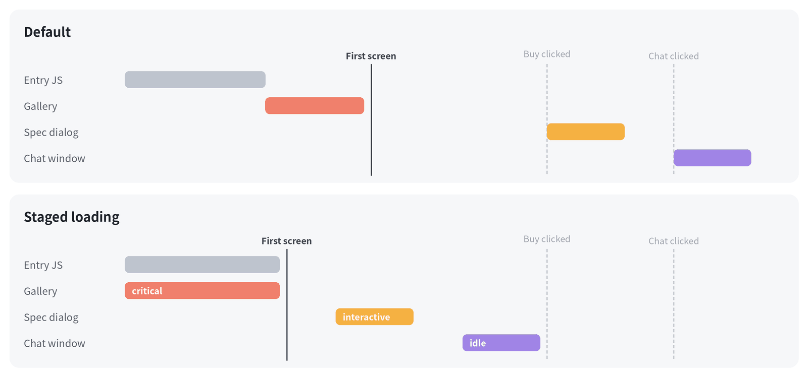

# Staged Resource Loading

Staged resource loading controls **when the code split out by `import()` starts downloading**: you mark at the `import()` which stage of the page needs the code, and Modern.js downloads it early when that stage arrives. For the full configuration, see [`performance.resourceStages`](/configure/app/performance/resource-stages).

:::warning Experimental
Staged resource loading is experimental. Its API and options may change in later versions.
:::

## Example

Take a product page. The three pieces of code below are all loaded on demand with `import()`:



- **Gallery**: shown on the first screen. By default it waits until the entry JS runs to the `import()`; marked `critical`, it downloads together with the entry JS, so the first screen shows earlier.
- **Spec dialog**: the dialog opened by "Buy". Before hydration finishes, clicking "Buy" does nothing, so the dialog cannot be needed yet; after hydration the user may click at any time. So it is marked `interactive`: it downloads right after hydration and is ready when the user clicks.
- **Chat window**: opened by "Chat", rarely used. Marked `idle`: it downloads once the page is idle, without competing with the code above, and is also ready when the user clicks.

:::tip A stage only makes a download earlier, never later
When the code calls `import()` and the file has not been downloaded, it starts downloading right away. A component rendered on the first screen, for example, loads when it renders, even if it is marked `idle`. A stage does not change when code runs either; a wrong stage only affects speed, never functionality.
:::

## Quick start

### 1. Mark the stage

Import `stagedImport` from `@modern-js/runtime/resources` and wrap your existing `() => import()`:

```tsx
import { lazy } from 'react';
import { stagedImport } from '@modern-js/runtime/resources';

// Before: const Gallery = lazy(() => import('./Gallery'));
const Gallery = lazy(stagedImport.critical(() => import('./Gallery')));
const SpecDialog = lazy(stagedImport.interactive(() => import('./SpecDialog')));
const ChatWindow = lazy(stagedImport.idle(() => import('./ChatWindow')));
```

`stagedImport.<stage>(fn)` returns a function used exactly like `fn`: pass it to `React.lazy` or `loadable`, or call it directly. No configuration is needed for built-in stages.

### 2. Build

After a build, `dist/resource-stages.json` lists the files of each stage and their sizes. When a stage exceeds its budget the build prints a warning; it does not fail.

### 3. Check in the browser

Open the page and run `window.__MODERN_RS__.report()` in the console. It shows when each stage arrived, and when each file started downloading and was needed by the code. See [Check and adjust](#check-and-adjust).

## Choose a stage

| Stage         | When the download starts                                      | Good for                                                                           |
| ------------- | ------------------------------------------------------------- | ---------------------------------------------------------------------------------- |
| `critical`    | Together with the entry JS                                    | Code the first screen renders, such as the gallery                                 |
| `visible`     | After the first screen shows                                  | Code rendered soon but not on the first screen, such as a list rendered on scroll  |
| `interactive` | After hydration (after the first render for client rendering) | Code most likely needed once the page responds, such as the dialog opened by "Buy" |
| `idle`        | After the page has loaded and the network is quiet            | Code that may be needed but is not urgent, such as a chat window                   |
| `viewport`    | When the bound element enters the viewport                    | Code needed near a certain area                                                    |
| `interaction` | When the bound element is hovered, focused or touched         | Code needed on clear intent, such as the share panel when hovering "Share"         |

`critical`, `visible`, `interactive` and `idle` download in order: a stage starts after the files of the previous one have downloaded, so later stages never compete with earlier ones for bandwidth.

For `viewport` and `interaction`, attach the loader's `trigger` to the element:

```tsx
const loadSharePanel = stagedImport.interaction(() => import('./SharePanel'));
const SharePanel = lazy(loadSharePanel);

<button ref={loadSharePanel.trigger}>Share</button>;
```

### Load on your application's own timeline

When the built-in stages do not fit, configure [`stages`](/configure/app/performance/resource-stages#stages):

```ts title="modern.config.ts"
export default defineConfig({
  performance: {
    resourceStages: {
      stages: {
        // New stage: download the checkout page after adding to cart; starts anyway 10 s after interactive without a notice
        addedToCart: { after: 'interactive', timeout: 10000 },
        // Built-in stage marked by the app: interactive once the product data has loaded and the buttons work
        interactive: { manual: true, timeout: 3000 },
      },
    },
  },
});
```

Use it in code and call `mark()` at the right moment:

```ts
const Checkout = lazy(stagedImport.addedToCart(() => import('./Checkout')));
cart.onAdd(() => stagedImport.addedToCart.mark());

await fetchProduct();
stagedImport.interactive.mark();
```

Code that should run after a stage has downloaded can wait for `stagedImport.<stage>.ready()`, for example `stagedImport.idle.ready().then(warmUp)`.

## How to write declarations

The build finds the files behind each declaration in the source, so declarations must be statically recognizable:

```tsx
// ✅ A function returning import('<fixed path>')
stagedImport.idle(() => import('./ChatWindow'));

// ✅ async/await, or .then() after import() to pick a named export
stagedImport.idle(() =>
  import('./ChatWindow').then(m => ({ default: m.ChatWindow })),
);

// ❌ The path is built from a variable, so the build cannot tell which file it is
stagedImport.idle(() => import(`./windows/${name}`));

// ✅ With string SSR, write the declaration inside the loadable call; the server renders it as usual
const SpecDialog = loadable(
  stagedImport.interactive(() => import('./SpecDialog')),
);

// ❌ Assigned to a variable first: the server does not render the component
const load = stagedImport.interactive(() => import('./SpecDialog'));
const SpecDialog2 = loadable(load);
```

When a declaration cannot be recognized, or its stage is neither built in nor configured, the build prints a warning. The declaration is not downloaded early; the code still loads normally when used.

## Download route JS early with streaming SSR

Streaming SSR only outputs the CSS of the matched routes in the HTML; their JS starts downloading after the entry JS has run. With [`streamingRoutePreload`](/configure/app/performance/resource-stages#streamingroutepreload), the JS of the matched routes downloads together with the entry JS, with no declarations in code:

```ts title="modern.config.ts"
export default defineConfig({
  performance: {
    resourceStages: {
      streamingRoutePreload: true,
    },
  },
});
```

## Check and adjust

During development, run `window.__MODERN_RS__.report()` in the console. In production, send the report when the page is closed:

```ts
import { onResourceStageReport } from '@modern-js/runtime/resources';

onResourceStageReport(report => sendToMonitor(report));
```

Adjust from the report:

| What you see                                          | What to do                            |
| ----------------------------------------------------- | ------------------------------------- |
| Downloaded early but never used                       | Move it one stage later, or remove it |
| Often used before its early download finished         | Move it one stage earlier             |
| Not declared, but used before the page is interactive | Consider declaring it                 |

Leave out records whose `prefetchStatus` is not `ok`; those files were not downloaded.

## Limitations

- Browsers without `<link rel="prefetch">`, such as Safari, skip early downloads other than `critical`; the code loads normally when used.
- `node_modules` is not scanned by default; declarations in third-party packages need [`include`](/configure/app/performance/resource-stages#include). Workspace packages linked in a monorepo are scanned directly.
- Client-rendered pages, and server-rendered pages that fall back to client rendering, only output entry-level `critical` files in the HTML; declarations in routes start downloading after the route matches.
- With `output.assetPrefix` set to `'auto'`, preload URLs cannot be written into the HTML, so `critical` downloads after the first screen shows instead.
- Micro-frontend sub-apps and Module Federation remotes are not supported; declare stages in the host app.
