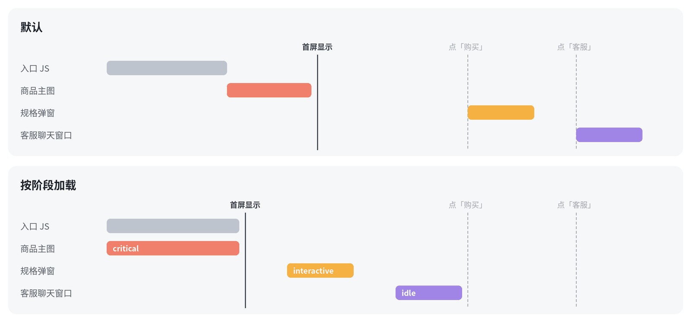

# 按阶段加载

按阶段加载用来控制 `import()` 拆出的代码**什么时候开始下载**：在 `import()` 处标明代码在页面的哪个阶段会用到，Modern.js 在这个阶段到来时提前下载它。完整配置见 [`performance.resourceStages`](/configure/app/performance/resource-stages)。

:::warning 实验性
按阶段加载目前是实验性功能，API 和配置项在后续版本中可能调整。
:::

## 示例

以一个商品详情页为例，下面三块代码都是用 `import()` 按需加载的：



- **商品主图**：首屏就要显示。默认要等入口 JS 执行到 `import()` 才开始下载；标为 `critical` 后和入口 JS 同时下载，首屏更早显示。
- **规格弹窗**：点「购买」时打开的弹窗。页面水合完成前，「购买」按钮点了没有反应，弹窗不会被用到；水合完成后随时可能被点。所以标为 `interactive`：水合完成后马上下载，用户点的时候已经下好。
- **客服聊天窗口**：点「客服」才打开，很少用。标为 `idle`：页面空闲后再下载，不和前面的代码抢带宽，用户点的时候也已经下好。

:::tip 阶段只能让下载提前，不会推迟
代码真正调用 `import()` 时，文件如果还没下载，会立即开始下载。例如首屏就渲染的组件，渲染时就会加载，标成 `idle` 也不会推迟。阶段也不改变代码什么时候执行，标错只影响快慢，不会让功能出错。
:::

## 快速开始

### 1. 标明阶段

从 `@modern-js/runtime/resources` 引入 `stagedImport`，把原来的 `() => import()` 包起来：

```tsx
import { lazy } from 'react';
import { stagedImport } from '@modern-js/runtime/resources';

// 之前：const Gallery = lazy(() => import('./Gallery'));
const Gallery = lazy(stagedImport.critical(() => import('./Gallery')));
const SpecDialog = lazy(stagedImport.interactive(() => import('./SpecDialog')));
const ChatWindow = lazy(stagedImport.idle(() => import('./ChatWindow')));
```

`stagedImport.<阶段>(fn)` 返回的函数和 `fn` 用法相同，可以交给 `React.lazy`、`loadable`，也可以直接调用。只用内置阶段时不需要任何配置。

### 2. 构建

构建后 `dist/resource-stages.json` 列出每个阶段有哪些文件、多大。某个阶段超出预算时构建会告警，不会失败。

### 3. 在浏览器里检查

打开页面，在控制台执行 `window.__MODERN_RS__.report()`，可以看到每个阶段什么时候到来、每个文件什么时候开始下载、什么时候被代码用到。调整方法见[检查和调整](#检查和调整)。

## 选择阶段

| 阶段          | 什么时候开始下载                             | 适合放什么                                                       |
| ------------- | -------------------------------------------- | ---------------------------------------------------------------- |
| `critical`    | 和入口 JS 同时下载                           | 首屏要渲染的代码，如商品主图                                     |
| `visible`     | 首屏显示之后                                 | 首屏不渲染、稍后就会渲染的代码，如滚动到下方才渲染的推荐列表     |
| `interactive` | 水合完成之后（客户端渲染为首次渲染完成之后） | 页面能操作后最可能马上用到的代码，如点「购买」打开的规格弹窗     |
| `idle`        | 页面加载完成、网络空闲之后                   | 可能用到但不急的代码，如客服聊天窗口                             |
| `viewport`    | 绑定的元素进入视口时                         | 靠近某个区域才会用到的代码                                       |
| `interaction` | 绑定的元素被鼠标移入、获得焦点或被触摸时     | 用户有明显意图时才用到的代码，如鼠标移到「分享」上时下载分享面板 |

`critical`、`visible`、`interactive`、`idle` 按顺序下载：前一个阶段的文件下载完，才开始下载下一个阶段，后面的阶段不和前面的阶段抢带宽。

`viewport` 和 `interaction` 要把加载函数的 `trigger` 绑定到元素上：

```tsx
const loadSharePanel = stagedImport.interaction(() => import('./SharePanel'));
const SharePanel = lazy(loadSharePanel);

<button ref={loadSharePanel.trigger}>分享</button>;
```

### 按应用自己的时机加载

内置阶段不合适时，可以在 [`stages`](/configure/app/performance/resource-stages#stages) 中配置：

```ts title="modern.config.ts"
export default defineConfig({
  performance: {
    resourceStages: {
      stages: {
        // 新增阶段：加入购物车后下载结算页，interactive 之后 10 秒内没有通知也会自动开始
        addedToCart: { after: 'interactive', timeout: 10000 },
        // 内置阶段改为由应用通知：商品数据请求完成、按钮可用后才算可交互
        interactive: { manual: true, timeout: 3000 },
      },
    },
  },
});
```

在代码中使用，并在对应时机调用 `mark()`：

```ts
const Checkout = lazy(stagedImport.addedToCart(() => import('./Checkout')));
cart.onAdd(() => stagedImport.addedToCart.mark());

await fetchProduct();
stagedImport.interactive.mark();
```

需要在某个阶段下载完成后再执行的代码，可以等 `stagedImport.<阶段>.ready()`，例如 `stagedImport.idle.ready().then(warmUp)`。

## 写法要求

构建时要从源码里找出每个声明对应的文件，写法需要能被静态识别：

```tsx
// ✅ 参数是返回 import('<固定路径>') 的函数
stagedImport.idle(() => import('./ChatWindow'));

// ✅ 可以用 async/await，或在 import() 后接 .then() 取具名导出
stagedImport.idle(() =>
  import('./ChatWindow').then(m => ({ default: m.ChatWindow })),
);

// ❌ 路径由变量拼接，构建时无法确定文件
stagedImport.idle(() => import(`./windows/${name}`));

// ✅ 字符串 SSR 下交给 loadable，声明直接写在 loadable 调用里，服务端照常渲染
const SpecDialog = loadable(
  stagedImport.interactive(() => import('./SpecDialog')),
);

// ❌ 先赋值给变量再交给 loadable，服务端不会渲染该组件
const load = stagedImport.interactive(() => import('./SpecDialog'));
const SpecDialog2 = loadable(load);
```

写法无法识别，或阶段名既不是内置阶段也没有配置时，构建告警，该声明不会提前下载，代码仍在用到时正常加载。

## 流式 SSR 提前下载路由 JS

流式 SSR 只在 HTML 中输出命中路由的 CSS，路由 JS 要等入口 JS 执行后才开始下载。开启 [`streamingRoutePreload`](/configure/app/performance/resource-stages#streamingroutepreload) 后，命中路由的 JS 和入口 JS 同时下载，不需要在代码中声明：

```ts title="modern.config.ts"
export default defineConfig({
  performance: {
    resourceStages: {
      streamingRoutePreload: true,
    },
  },
});
```

## 检查和调整

开发时在控制台执行 `window.__MODERN_RS__.report()`；线上可以在页面关闭时上报：

```ts
import { onResourceStageReport } from '@modern-js/runtime/resources';

onResourceStageReport(report => sendToMonitor(report));
```

根据记录调整：

| 现象                             | 调整                   |
| -------------------------------- | ---------------------- |
| 提前下载了，但一直没被用到       | 降一个阶段，或去掉声明 |
| 经常在提前下载完成之前就被用到   | 升一个阶段             |
| 没有声明，但在可交互之前就被用到 | 考虑补上声明           |

`prefetchStatus` 不是 `ok` 的记录不要计入，这些文件没有下载成功。

## 限制

- 不支持 `<link rel="prefetch">` 的浏览器（如 Safari）会跳过 `critical` 以外的提前下载，代码在用到时正常加载。
- 默认不扫描 `node_modules`，第三方包里的声明需要配置 [`include`](/configure/app/performance/resource-stages#include)。monorepo 中通过软链引用的工作区包会直接扫描。
- 客户端渲染的页面、以及服务端渲染降级为客户端渲染时，HTML 中只输出入口级的 `critical`，路由里的声明在路由匹配后才开始下载。
- `output.assetPrefix` 为 `'auto'` 时无法在 HTML 中写出 preload 地址，`critical` 改为首屏显示后下载。
- 不支持微前端子应用和 Module Federation 的 remote，请在主应用中声明。
